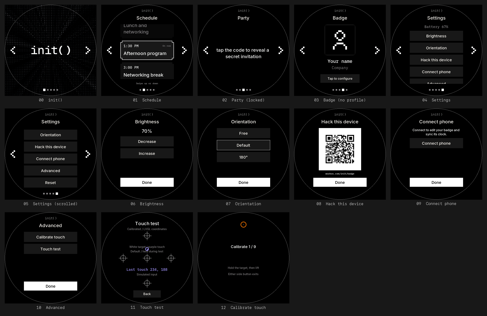

# Badge views (v1.0.0)

Native framebuffer captures of every reachable public view, taken over USB
`capture_badge` from the development badge on October 2, 2026. These are
device observations of firmware v1.0.0, not host renders; later releases may
differ.

- `badge-views-v1.0.0.png`: labelled grid with the round screen outlined.
- `badge-views-v1.0.0-strip.png`: unlabelled 468×466 frames side by side, in
  grid order.
- `frames/`: one exact PNG per view, numbered to match the grid.

| # | View | # | View |
|---|------|---|------|
| 00 | init() | 07 | Orientation |
| 01 | Schedule (1:30 PM current) | 08 | Hack this device |
| 02 | Party, locked | 09 | Connect phone |
| 03 | Badge, no profile | 10 | Advanced |
| 04 | Settings | 11 | Touch test |
| 05 | Settings, scrolled | 12 | Calibrate touch, step 1 |
| 06 | Brightness | | |

State at capture: no profile, Party locked, Default orientation, 70%
brightness. Navigation and taps were USB-simulated; the Touch test marker at
234, 188 is that simulated tap. No preferences were written.

Not captured: the Reset confirmation, unlocked Party and its QR, a configured
Badge and its QR (they would show personal data), and phone setup (capture is
rejected while setup runs, and setup starts Wi-Fi).
